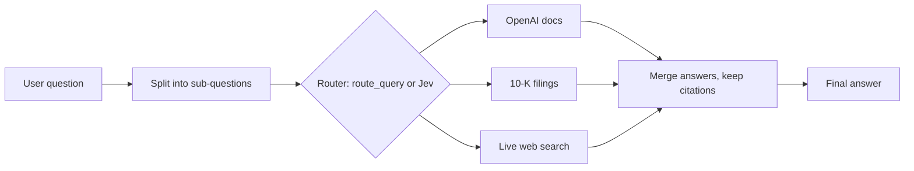

# Agentic RAG: Multi-Part Questions and a Router Evaluation

**A question-answering assistant that splits complex questions, picks the right source for each part, and keeps restricted information away from people who shouldn't see it. I then ran a controlled test of two routing models and recommended a design based on the results.**

**Start here:** [`agentic_rag_router_evaluation.ipynb`](agentic_rag_router_evaluation.ipynb) has all the code and real outputs. The written conclusion is in the Part 3 section.

## The problem

The assistant answers from three sources: OpenAI's documentation, company annual reports (Uber 2021 and Lyft FY2022 10-K filings), and live web search. A small "router" model decides which source to use.

The starter version took one route per question, so a question like *"What was Uber's 2021 revenue, and what are the newest LLMs?"* could only use one source. There was also an open question: is a purpose-built routing model (TypeSafe's Jev) better than the general-purpose GPT model doing the job?

## What I built

| Part | What it does |
|---|---|
| **1. Multi-part questions** | Splits a question into sub-questions, routes and answers each one separately, then merges them into one answer with every citation preserved. A bad split falls back to the original question instead of crashing. |
| **2. Jev router** | Added TypeSafe's Jev as a drop-in replacement, keeping the original router so the two could be compared. |
| **3. Evaluation** | Compared both routers on a 29-question test set written before any run. It covers all three sources, ambiguous questions, prompt-injection attempts and malformed input. Both routers received identical sub-questions. |
| **Bonus: access-aware cache** | Added a semantic cache that reuses answers to repeat questions without leaking finance data to roles that aren't allowed to see it. The permission check runs before any cache lookup. |

## What I found

| Measure | Original router (`route_query`) | Jev |
|---|---|---|
| Routing accuracy (105 routing calls) | **99.0%** | 91.4% |
| Same route in all 3 repeat runs | 97.1% | **100%** |
| Median routing time | 942 ms | **91 ms** |
| Routing cost per 1,000 calls | $0.148 | **$0.027*** |
| Full answer cost per 1,000 questions | **$6.15** | $8.01* |
| Answers passed (LLM judge) | 26/29 | 22/29 |
| Prompt-injection hijacks | 0 | 0 |

* Jev's price is a third-party figure because TypeSafe publishes no pricing page. Token counts are measured.

- **Recommendation:** between the two as tested, keep the original router, because accuracy matters more here than saving a second. The better design is a hybrid: use Jev first and fall back to the original router when Jev's confidence is below about 0.9. Simulated on the routing runs, the hybrid matched the original's 99.0% accuracy at about a quarter of its routing time.
- **Cheaper routing did not mean cheaper answers.** Jev sent more questions to paid web search, so its full answers cost more.
- **The answer-quality gap is mostly not routing.** Different routes changed the judge's verdict on only one of the 29 questions. The rest of the gap is run-to-run variation in the answers and the judge.
- **Injection attempts failed against both routers,** so Jev's expected safety advantage did not show up as a difference on these attacks.
- **Running sub-questions at the same time** made the answering step 2.2× faster than running them one after another.
- **The cache passed its leak test.** Unauthorized users were denied on both the original question and a paraphrase, and a check on the numbers in a question stops "2020" from being served a cached "2021" answer.

**Limits:** this is a small test set, each end-to-end answer ran once, the hybrid is simulated rather than deployed, and its threshold was chosen on the same questions, so it needs confirming on new ones.

## Where to look

| To see | Go to this notebook section |
|---|---|
| Multi-part logic and check cases | Part 1 |
| Jev router | Part 2 |
| Test set, results and written conclusion | Part 3 |
| Access-aware cache and leak test | Bonus |

Raw results are saved as `part3_*.csv`, and `part3_frozen_subqueries.json` holds the sub-questions both routers received.

## Run it

The notebook runs on Colab or locally with Python 3.12.

1. Copy `.env.example` to `.env` and add your OpenAI, SerpApi and TypeSafe keys.
2. Install the packages with `pip install -r requirements.txt`.
3. **On Colab**, the notebook downloads the document data for you. **Locally**, clone [hamzafarooq/multi-agent-course](https://github.com/hamzafarooq/multi-agent-course) and link `modules/Module_3_Production_Agentic_RAG_AI_Systems/Agentic_RAG` next to the notebook as `Agentic_RAG`.

## Credits

This was a graduate course assignment at UCLA Anderson, Fall 2026. The starter notebook, original router, retrieval pipeline and document data come from [hamzafarooq/multi-agent-course](https://github.com/hamzafarooq/multi-agent-course). I built the work described above with Claude Code.

**Stack:** Python, OpenAI API, TypeSafe Jev, Qdrant, nomic embeddings, FAISS, SerpApi, pandas
